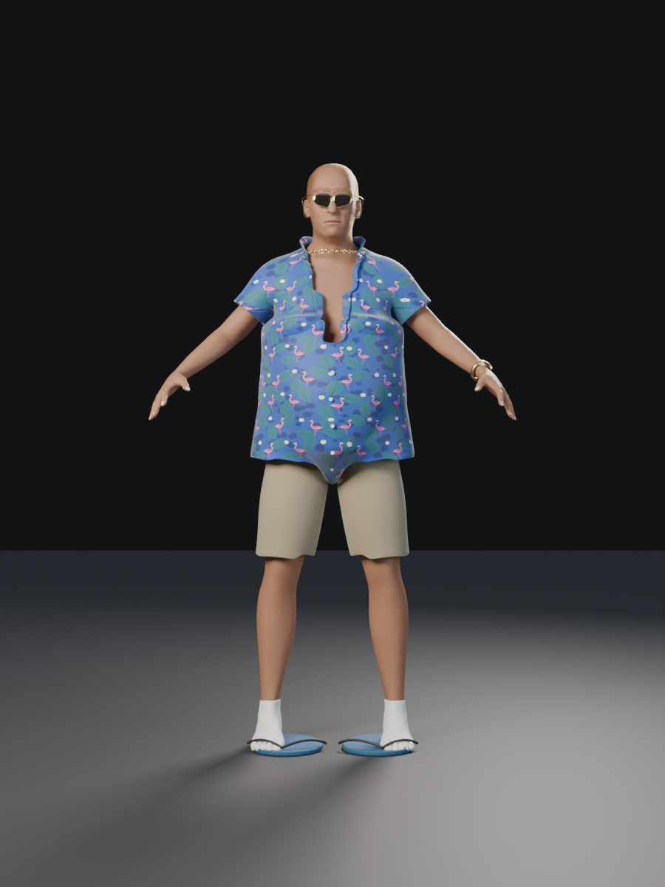
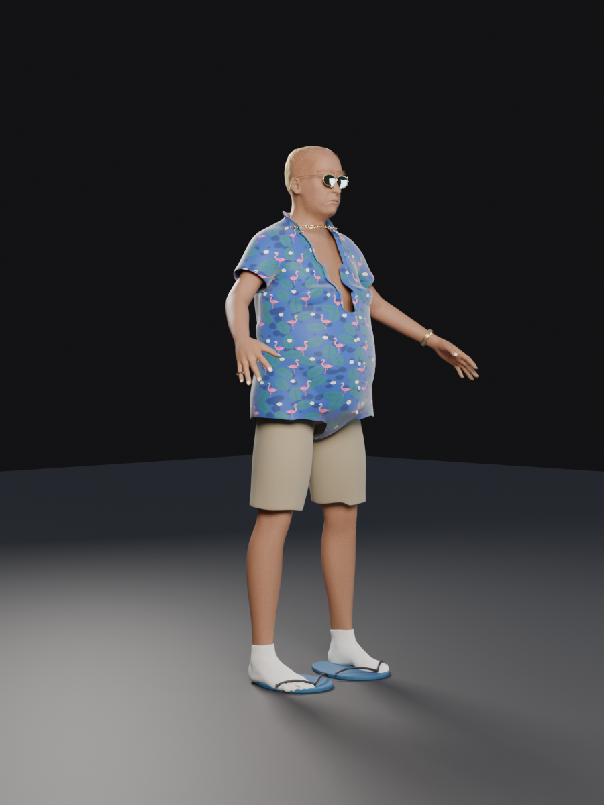

# Rex Magnum: Vacation Violence

The full project brief is in [CLAUDE.md](CLAUDE.md). Claude Code reads it at the start of every session.

## Build order status

| # | Step | Status |
|---|---|---|
| 1 | PC specs check + safe settings | Waiting: run the command below and send the result |
| 2 | Rex: front/side pictures → approval → rig, first-person arms, animations | Pictures ready, waiting for approval |
| 3 | Tourist blob → other 3 blobs | Not started |
| 4 | Bottle, towel, knife → other weapons | Not started |
| 5 | Island rough map + 3 view pictures | Not started |
| 6 | First playable (room 304 + pool) | Not started |
| 7 | Other zones, one at a time | Not started |
| 8 | Accomplishments, album, settings, remap, save | Not started |

## Step 1: PC specs check

Open **PowerShell** and paste this. It only reads information. It changes nothing.

```powershell
Get-CimInstance Win32_VideoController | Select-Object Name, @{n='VRAM_GB';e={[math]::Round($_.AdapterRAM/1GB,1)}}, DriverVersion | Format-Table -AutoSize
Get-CimInstance Win32_Processor | Select-Object Name, NumberOfCores | Format-Table -AutoSize
"RAM GB: " + [math]::Round((Get-CimInstance Win32_ComputerSystem).TotalPhysicalMemory/1GB,1)
Get-PSDrive -PSProvider FileSystem | Select-Object Name, @{n='Free_GB';e={[math]::Round($_.Free/1GB,1)}} | Format-Table -AutoSize
Get-ChildItem "C:\Program Files\Blender Foundation" -ErrorAction SilentlyContinue | Select-Object Name
Get-ChildItem "C:\Program Files\Unity\Hub\Editor" -ErrorAction SilentlyContinue | Select-Object Name
Get-ChildItem "C:\Program Files\Unity\Hub\Editor\*\Editor\Data\PlaybackEngines" -ErrorAction SilentlyContinue | Select-Object Name
```

Copy all the text that PowerShell shows, and paste it into the chat.

Note: Windows shows a maximum of 4 GB VRAM for some graphics cards. Claude checks the card name to find the real amount.

## Step 2: Rex (approval pictures)

| Front | Side |
|---|---|
|  |  |

| 3/4 | Face |
|---|---|
|  |  |

### Make Rex on your PC (optional)

You need Blender 5.x with the MPFB extension (you have it). Close Blender. Then run this in PowerShell (it is one command). It takes about 5–15 minutes, and Blender shows no window. To stop it, press **Ctrl + C** in PowerShell.

```powershell
& "C:\Program Files\Blender Foundation\Blender 5.2\blender.exe" -b --python "<repo folder>\RexMagnum\Blender\build_rex.py" -- --save "<your folder>\Rex_v01.blend" --out "<your folder>\Renders"
```

Add `--preview` for fast, small test pictures.

### Files

| File | What it does |
|---|---|
| `Blender/build_rex.py` | Main script: builds Rex, saves the .blend file, renders the pictures |
| `Blender/rex_body.py` | MPFB body: age 58, thin arms, narrow shoulders, soft belly |
| `Blender/rex_look.py` | Tan skin, eyes, hair, stubble, sunglasses, shirt, shorts, socks, flip-flops, gold jewelry |
| `Blender/rex_render.py` | Cycles approval lights and cameras (key, fill and rim lights) |
| `Blender/rex_flamingo_print.py` | Draws the shirt print (original pattern) |
| `Blender/textures/rex_shirt_flamingo.png` | The shirt print |

### After approval (next steps for Rex)

1. Hero pose and idle pose (chest out / belly out).
2. Mixamo-compatible humanoid rig, with the clothes and jewelry fitted to the rig.
3. Face blend shapes: blink, talk (A/E/O/M), smile, smug grin.
4. First-person arms: a separate, high-detail model with full finger bones.
5. Export: FBX, GLB, Unity prefab.
