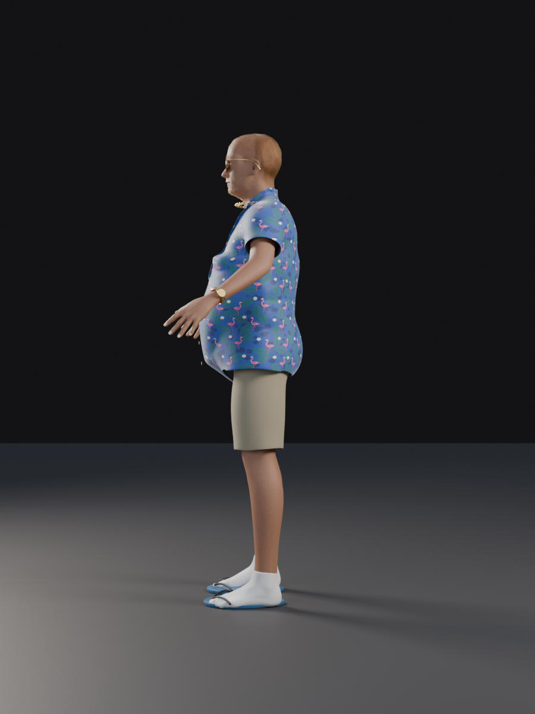
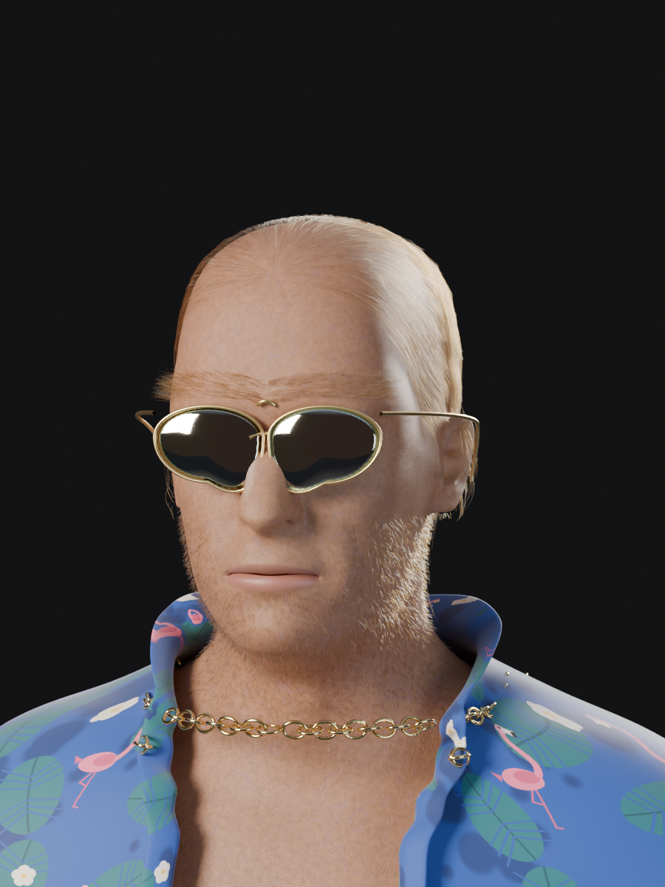
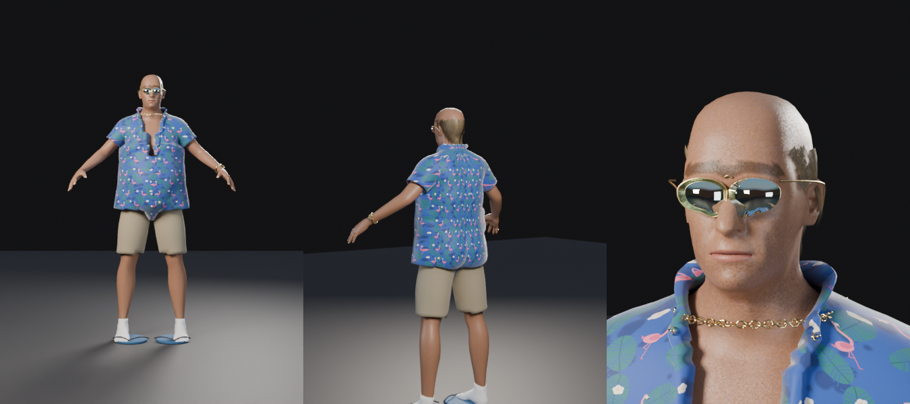
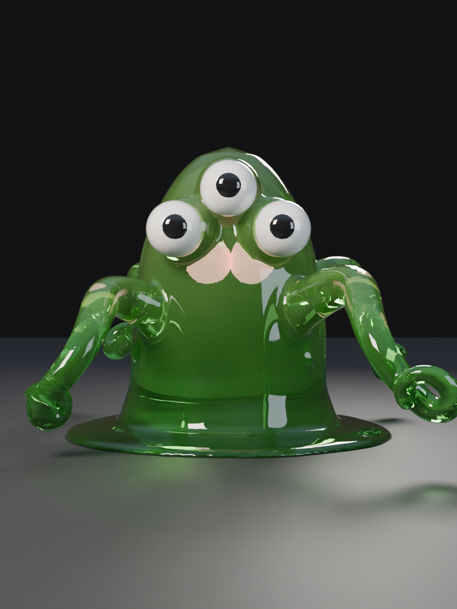

# Rex Magnum: Vacation Violence

The full project brief is in [CLAUDE.md](CLAUDE.md). Claude Code reads it at the start of every session.

## Build order status

| # | Step | Status |
|---|---|---|
| 1 | PC specs check + safe settings | Waiting: run the command below and send the result |
| 2 | Rex: front/side pictures → approval → rig, first-person arms, animations | Done (v1). Ready to test in Unity |
| 3 | Tourist blob → other 3 blobs | Done (v1): models, rigs, 13 animations each, Unity AI |
| 4 | Bottle, towel, knife → other weapons | Not started |
| 5 | Island rough map + 3 view pictures | Not started |
| 6 | First playable (room 304 + pool) | Not started |
| 7 | Other zones, one at a time | Not started |
| 8 | Accomplishments, album, settings, remap, save | Not started |

## Step 1: PC specs check

Open **PowerShell** and paste this. It only reads information. It changes nothing.

```powershell
Get-CimInstance Win32_VideoController | Select-Object Name, @{n='VRAM_GB';e={[math]::Round($_.AdapterRAM/1GB,1)}}, DriverVersion | Format-Table -AutoSize
Get-CimInstance Win32_Processor | Select-Object Name, NumberOfCores | Format-Table -AutoSize
"RAM GB: " + [math]::Round((Get-CimInstance Win32_ComputerSystem).TotalPhysicalMemory/1GB,1)
Get-PSDrive -PSProvider FileSystem | Select-Object Name, @{n='Free_GB';e={[math]::Round($_.Free/1GB,1)}} | Format-Table -AutoSize
Get-ChildItem "C:\Program Files\Blender Foundation" -ErrorAction SilentlyContinue | Select-Object Name
Get-ChildItem "C:\Program Files\Unity\Hub\Editor" -ErrorAction SilentlyContinue | Select-Object Name
Get-ChildItem "C:\Program Files\Unity\Hub\Editor\*\Editor\Data\PlaybackEngines" -ErrorAction SilentlyContinue | Select-Object Name
```

Copy all the text that PowerShell shows, and paste it into the chat.

Note: Windows shows a maximum of 4 GB VRAM for some graphics cards. Claude checks the card name to find the real amount.

## Step 2: Rex (approval pictures)

| Front | Side |
|---|---|
|  |  |

| 3/4 | Face |
|---|---|
|  |  |

### Make Rex on your PC (optional)

You need Blender 5.x with the MPFB extension (you have it). Close Blender. Then run this in PowerShell (it is one command). It takes about 5–15 minutes, and Blender shows no window. To stop it, press **Ctrl + C** in PowerShell.

```powershell
& "C:\Program Files\Blender Foundation\Blender 5.2\blender.exe" -b --python "<repo folder>\RexMagnum\Blender\build_rex.py" -- --save "<your folder>\Rex_v01.blend" --out "<your folder>\Renders"
```

Add `--preview` for fast, small test pictures.

### Files

| File | What it does |
|---|---|
| `Blender/build_rex.py` | Main script: builds Rex, saves the .blend file, renders the pictures |
| `Blender/rex_body.py` | MPFB body: age 58, thin arms, narrow shoulders, soft belly |
| `Blender/rex_look.py` | Tan skin, eyes, hair, stubble, sunglasses, shirt, shorts, socks, flip-flops, gold jewelry |
| `Blender/rex_render.py` | Cycles approval lights and cameras (key, fill and rim lights) |
| `Blender/rex_flamingo_print.py` | Draws the shirt print (original pattern) |
| `Blender/textures/rex_shirt_flamingo.png` | The shirt print |

### After approval (next steps for Rex)

1. Hero pose and idle pose (chest out / belly out).
   The game has first-person AND third-person modes, so the full body needs animations for every action.
2. Mixamo-compatible humanoid rig, with the clothes and jewelry fitted to the rig.
3. Face blend shapes: blink, talk (A/E/O/M), smile, smug grin.
4. First-person arms: a separate, high-detail model with full finger bones.
5. Export: FBX, GLB, Unity prefab.

## Try Rex in Unity (first person + third person)



### What is ready

| Item | Details |
|---|---|
| `Unity/Assets/RexMagnum/Characters/Rex/Rex.fbx` | Third-person Rex: 67k triangles, rig with 64 bones, 8 face shapes, 14 animations |
| `.../Rex_FPArms.fbx` | First-person arms: high detail (subdivided), same rig and animations |
| `.../Textures/` | Baked skin (2K), hair cards, shirt print. Phones get 1K (ASTC). |
| `Export/Rex.glb` | Web/phone copy |
| `Blender/Rex_v01.blend` | Full-detail source |
| Scripts | `RexController` (move), `RexCameraRig` (first/third person), `RexActions` (punch, taunt, photo, hands), `RexFace` (blink, smile, talk) |

### Steps

1. Your Unity project must use **URP** and the **Input System** package (Unity 6 templates have both).
2. Copy the folder `RexMagnum/Unity/Assets/RexMagnum` into your Unity project's `Assets` folder.
3. In Unity, click **Rex Magnum → Build Rex + Test Scene**. Wait until it finishes.
4. Open `Assets/RexMagnum/Scenes/RexTest.unity`. Click **Play**.

### Test controls

| Key | Action |
|---|---|
| **V** (controller: R-stick click) | Switch first person ↔ third person |
| C (controller: D-pad left) | Swap shoulder (third person) |
| WASD + mouse | Move + look |
| Shift / Space | Run / jump |
| Left click | Tap = jab, hold = heavy punch |
| Right click | Aim (third-person camera zooms in) |
| T / P / H | Taunt / selfie photo / hands down-up |
| Esc | Pause (frees the mouse) |

Animations are version 1 (made by hand in code). The rig uses Mixamo bone names, so better Mixamo animations can replace them later.

## Blobs (build step 3)



| Blob | Look | Behavior in the game |
|---|---|---|
| Tourist (green) | Rex chest height, 3 eyes, 4 tentacles | Slow. Spits slime (arcs). Slime puddles make Rex slip. |
| Lifeguard (red) | Tall and thin, 2 eyes on stalks, 2 tentacles | Fast. Throws things from far away. |
| Bouncer (purple) | Wide, taller than Rex, 1 big eye, 4 thick tentacles | Strong tentacle whip. When it pops, it splits into 2 half-size blobs. |
| King Glorp (gold) | 4.2 m, 5 eyes, 6 tentacles, crown spikes | Boss: spits and whips, 1200 health. |

All blobs: one smooth jelly mesh (no seams), pink brain inside, cartoon eyes in slime sockets.
Animations (13 each): Idle, Slide, SlideFast, Whip, Spit, Throw, Hit, Stun (eyes roll), Angry, Rude (answer to Rex's taunt), Photo (confused), Pinned, Pop.
Leak, freeze + break and the bouncer split are done in Unity code.

Reactions to Rex: **Taunt (T)** → blobs show the rude tentacle, then get angry (darker, faster). **Photo (P)** → the nearest blob poses, confused. **Punch** → hit ripple; at 0 health the blob pops (slime burst, puddle, slime on the walls).

Files: `Unity/Assets/RexMagnum/Characters/Blobs/Blob_<Type>.fbx` (+ `.glb`), sources `Blender/Blob_<Type>_v01.blend` (model) and `_v02_rig.blend` (rig + animations).
In Unity, **Rex Magnum → Build Rex + Test Scene** also builds the blobs (or use **Rex Magnum → Build Blobs**). The test scene spawns Tourist, Lifeguard and Bouncer blobs.
